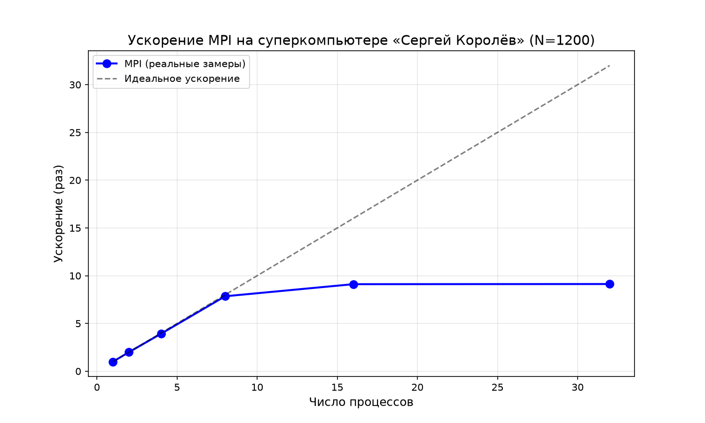
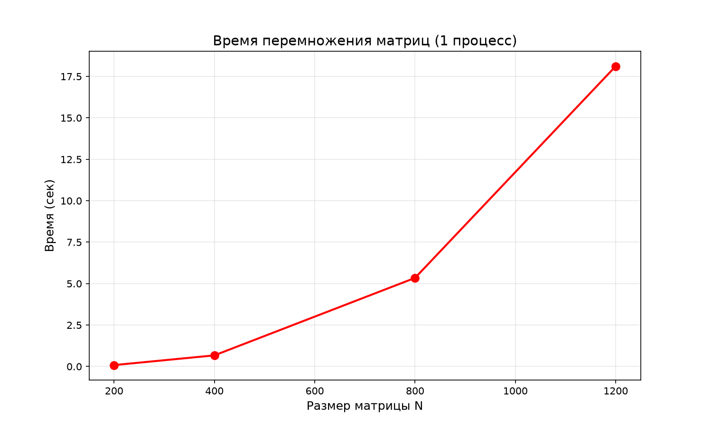

# Лабораторная работа №3: MPI умножение матриц

**Автор:** Сахнова Кристина

## О работе
В этой лабораторной нужно было модифицировать программу из ЛР №1 для параллельной работы по технологии MPI. Программа запускалась на суперкомпьютере «Сергей Королёв» через Slurm. В качестве проверки использовалась встроенная верификация (процесс 0 считает эталон последовательно и сравнивает с результатом MPI).

## Как реализовано
Умножение распараллелено по строкам: матрица A разбивается на горизонтальные блоки, каждый процесс считает свою часть. Используются коллективные операции `MPI_Bcast` и `MPI_Scatterv`/`MPI_Gatherv`.

## Эксперименты
Протестированы размеры матриц: 200, 400, 800, 1200. Для N=1600 и 2000 эксперименты не завершены из-за ограничений по памяти на узлах кластера.

**Результаты для N=200:**

| Процессы | Время (сек) | Ускорение | GFLOPS |
|---|---|---|---|
| 1 | 0.0849 | 1.00x | 0.188 |
| 2 | 0.0431 | 1.97x | 0.371 |
| 4 | 0.0214 | 3.96x | 0.746 |
| 8 | 0.0109 | 7.81x | 1.472 |
| 16 | 0.0098 | 8.63x | 1.626 |
| 32 | 0.0100 | 8.51x | 1.602 |

**Сводная таблица по всем размерам:**

| N | 1 проц. | 2 проц. | 4 проц. | 8 проц. | 16 проц. | 32 проц. |
|---|---|---|---|---|---|---|
| 200 | 0.085 | 0.043 | 0.021 | 0.011 | 0.010 | 0.010 |
| 400 | 0.671 | 0.336 | 0.170 | 0.085 | 0.074 | 0.078 |
| 800 | 5.345 | 2.680 | 1.355 | 0.685 | 0.603 | 0.587 |
| 1200 | 18.119 | 9.066 | 4.617 | 2.309 | 1.988 | 1.985 |

## Графики

### Ускорение от числа процессов (N=1200)

### Время перемножения матриц (1 процесс)

## Проверка
Результаты перемножения проверены встроенной верификацией. Для всех конфигураций **Max error = 0** (проверка пройдена).

## Выводы
1. **MPI реально ускоряет работу.** На 16 процессах матрица 1200x1200 считается почти 2 секунды вместо 18.
2. **Ускорение не бесконечное.** После 16 процессов время почти не падает из-за затрат на пересылку данных между процессами.
3. **Маленькие матрицы ускоряются лучше** (почти в 8.6 раз на N=200), а на больших ускорение уже не такое линейное.
4. **Производительность (GFLOPS) растёт** с 0.19 на 1 процессе до 1.7 на 16.
5. **Верификация пройдена везде** (Max error = 0). MPI-версия считает точно так же, как и обычная программа.
