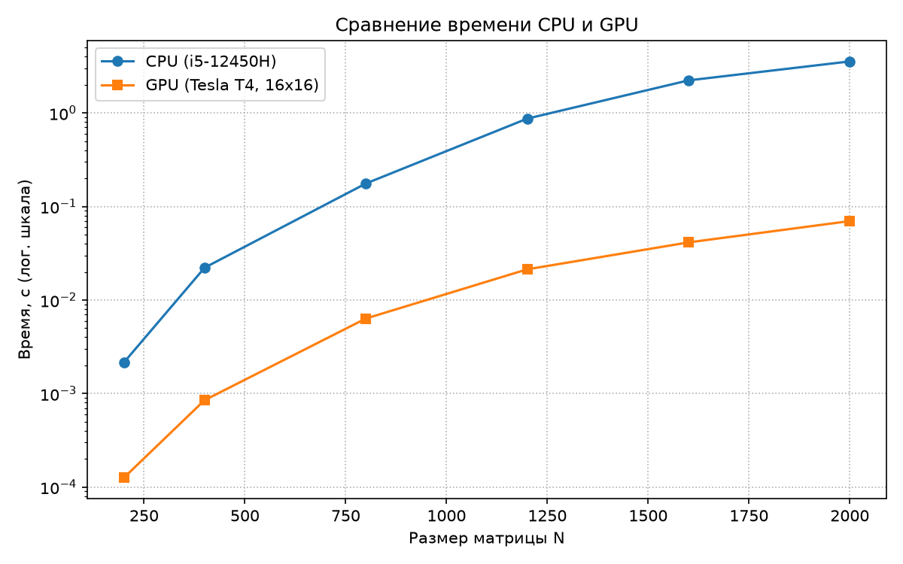
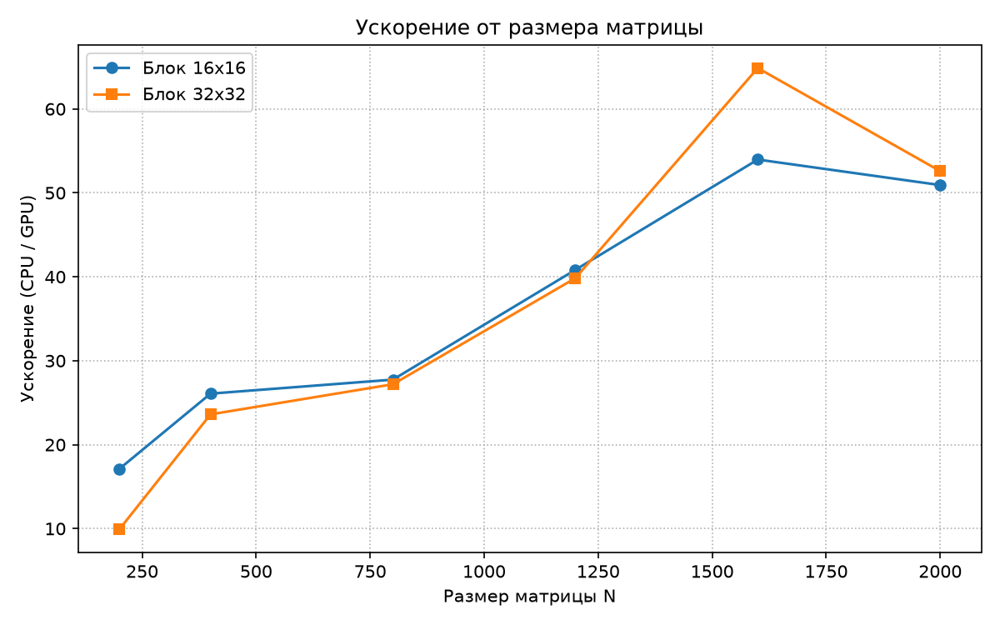
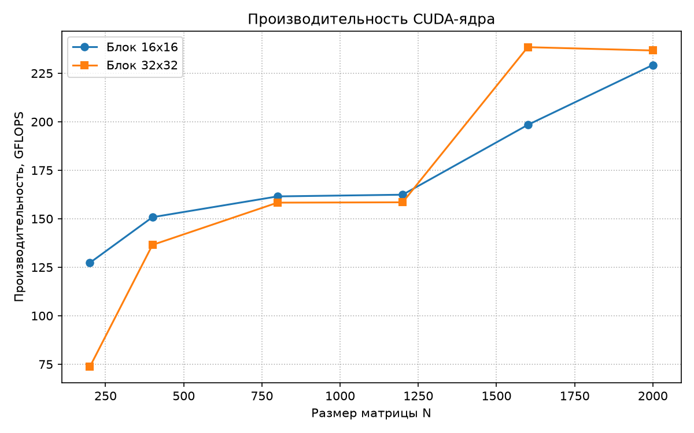

# Лабораторная работа №4: Параллельное умножение матриц (CUDA)

**Автор:** Сахнова Кристина

## 1. Цель работы
Модифицировать программу умножения матриц из лабораторной работы №1 для параллельной работы по технологии CUDA. Провести эксперименты с разными размерами матриц и конфигурациями сетки блоков.

## 2. Конфигурация системы
Локальный компьютер (Chuwi, Intel Core i5-12450H) не имеет видеокарты NVIDIA, поэтому эксперименты проводились в облачной среде **Google Colab**.
- GPU: **NVIDIA Tesla T4**.
- Компилятор: `nvcc -O3`.

## 3. Описание реализации
Умножение матриц реализовано на GPU. Каждый поток вычисляет ровно один элемент результирующей матрицы `C`.
Для запуска используется сетка блоков `dim3 blockSize(bs, bs)`. Эксперименты проводились для двух конфигураций: **16x16** (256 потоков) и **32x32** (1024 потока).

## 4. Результаты экспериментов

### Таблица 1. Время работы и ускорение

| N | Время CPU (с) | Время GPU 16x16 (с) | Время GPU 32x32 (с) | Ускорение (16x16) | Ускорение (32x32) |
|---|---|---|---|---|---|
| 200 | 0.002150 | 0.000126 | 0.000217 | 17.11 | 9.91 |
| 400 | 0.022140 | 0.000849 | 0.000938 | 26.08 | 23.61 |
| 800 | 0.175961 | 0.006340 | 0.006468 | 27.75 | 27.20 |
| 1200 | 0.868860 | 0.021281 | 0.021807 | 40.83 | 39.84 |
| 1600 | 2.228685 | 0.041295 | 0.034354 | 53.97 | 64.87 |
| 2000 | 3.554342 | 0.069784 | 0.067584 | 50.93 | 52.59 |

### Таблица 2. Производительность (GFLOPS)

| N | GPU 16x16 (GFLOPS) | GPU 32x32 (GFLOPS) |
|---|---|---|
| 200 | 127.30 | 73.71 |
| 400 | 150.80 | 136.51 |
| 800 | 161.52 | 158.31 |
| 1200 | 162.40 | 158.48 |
| 1600 | 198.38 | 238.46 |
| 2000 | 229.28 | 236.74 |

## 5. Графики

### Сравнение времени CPU и GPU

### Ускорение от размера матрицы

### Производительность (GFLOPS)

## 6. Выводы

1. **GPU в разы быстрее CPU.** Если на процессоре i5-12450H матрица 2000х2000 считалась больше 3.5 секунд, то видеокарта Tesla T4 справилась с ней всего за 0.07 секунды. Ускорение получилось от 17 до 64 раз в зависимости от размера.
2. **Размер блока имеет значение.** На матрицах поменьше (до 800) блок **16x16** оказался шустрее, видимо, из-за лучшего распределения задач по ядрам. 
3. **Для больших матриц лучше 32x32.** Начиная с N=1600, блок **32x32** обогнал 16x16 (ускорение достигло 64 раз). Большим матрицам выгоднее большие блоки, так как меньше накладных расходов.
4. **Итог.** Пиковая производительность вышла **238 GFLOPS**. Это в 10 раз больше, чем мы получали на OpenMP в прошлой лабе (там было максимум 18 GFLOPS). CUDA отлично подходит для таких задач, даже если запускать её удаленно в Colab.
