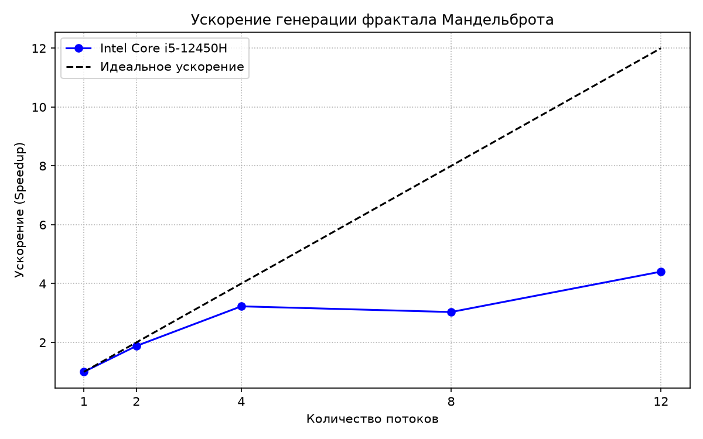

# Лабораторная работа №5 — Параллельная генерация фрактала Мандельброта (CS149 asst1, Program 1)

**Автор:** Сахнова Кристина

## 1. Цель работы
Распараллелить генерацию изображения множества Мандельброта с помощью `std::thread`. Провести эксперименты с разным числом потоков, найти причину нелинейного ускорения и подобрать разбиение, дающее максимальную производительность.

## 2. Описание реализации
Для распараллеливания использовался стандартный механизм C++ — `std::thread`. Каждый поток получает свой набор строк для обработки. 
Вместо классического блочного разбиения (когда потоку достается сплошной кусок изображения) было использовано **чередование строк (Interleaving)**. Поток с номером `i` вычисляет строки `i`, `i + numThreads`, `i + 2*numThreads` и так далее. 

Это позволяет равномерно распределить нагрузку, так как в центре фрактала вычислений значительно больше, чем по краям. При блочном разбиении один поток мог бы застрять на центре, пока остальные простаивали бы.

## 3. Результаты экспериментов
Замеры проводились на процессоре **Intel Core i5-12450H** (4 P-ядра, 4 E-ядра, 12 логических потоков).

### Таблица 1 — Время и ускорение

| Потоки | Время (сек) | Ускорение (Speedup) |
|--------|-------------|---------------------|
| 1      | 0.2278      | 1.00                |
| 2      | 0.1212      | 1.88                |
| 4      | 0.0706      | 3.23                |
| 8      | 0.0751      | 3.03                |
| 12     | 0.0517      | 4.41                |

### График ускорения

## 4. Выводы

1. **Ускорение нелинейно.** Из-за закона Амдала и накладных расходов на создание потоков кривая не совпадает с идеальной. Часть кода (создание потоков, распределение памяти) выполняется последовательно.
2. **Аномалия на 8 потоках.** Время выполнения хуже (0.0751), чем на 4 (0.0706). Это связано с гибридной архитектурой моего процессора. 4 потока идеально ложатся на быстрые P-ядра. А 8 потоков начинают нагружать медленные E-ядра, которые не справляются с нагрузкой и замедляют общую работу.
3. **Максимум.** На 12 потоках (когда включается Hyper-Threading) ускорение достигает 4.41x. Дальнейшее увеличение потоков не имеет смысла, так как мы достигли предела логических ядер.
4. **Эффективность алгоритма.** Чередование строк (Interleaving) сработало отлично — нагрузка распределилась равномерно, без простоев. При блочном разбиении ускорение на некоторых конфигурациях могло бы быть хуже из-за дисбаланса.
